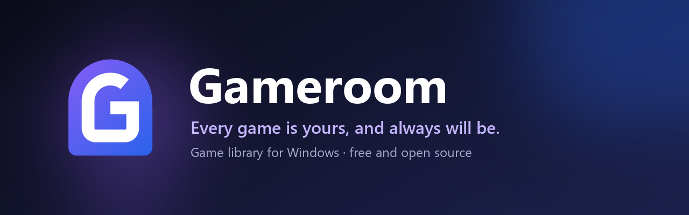

<p align="center">
  
</p>

<p align="center">
  <a href="https://github.com/Cyssel/Gameroom/releases/latest"></a>
  <a href="LICENSE.md"></a>
  
  <a href="https://www.paypal.com/donate/?business=Cysselx4%40gmail.com&item_name=Gameroom&currency_code=USD"></a>
</p>

<p align="center">
  <b>Every game is yours, and always will be.</b><br>
  A <b>free and open source</b> game library for Windows that brings all your games together,<br>
  knows what you're playing, tracks your playtime and protects your saves.
</p>

<p align="center">
  <a href="#-what-is-gameroom">About</a> ·
  <a href="#-features">Features</a> ·
  <a href="#%EF%B8%8F-how-it-works">How it works</a> ·
  <a href="#-installation">Installation</a> ·
  <a href="#%EF%B8%8F-your-own-cloud-supabase">Your own cloud</a> ·
  <a href="#%EF%B8%8F-building-from-source">Building</a> ·
  <a href="#-credits">Credits</a> ·
  <a href="#-buy-me-a-coffee">Buy me a coffee</a>
</p>

<p align="center">
  
</p>

---

## 🎮 What is Gameroom

Your games are scattered across Steam, Epic, Battle.net, EA, Riot, Xbox, standalone launchers, emulators and loose folders. **Gameroom brings them all into one library** that looks like a console home screen, and takes care of what stores don't do for you:

- **It knows what you're playing.** Games are recognized even when you start them from a shortcut, their folder or another store, and your playtime is counted minute by minute.
- **It backs up your saves** while you play, and gives them back after you reinstall a game or Windows.
- **It shows Steam achievements** for your games, even the ones you didn't install from Steam, with an in-game notification when you unlock one.

### Every game is yours, and always will be

That's the project's motto, and it's meant literally:

- **No store, no ads, no subscriptions.** Gameroom doesn't sell anything and doesn't need an account.
- **Your data stays on your PC.** Your library, playtime and save backups are stored on your own computer, in open formats.
- **Your cloud is yours.** If you want cloud saves, Gameroom keeps them on *your own* free Supabase server, not on ours. Nobody else can access them.
- **Open source (MIT).** You can read it, change it and share it. Even if the project disappeared tomorrow, your copy would keep working.

### Inspired by Playnite, rebuilt from the inside

Gameroom started as a fork of **[Playnite](https://github.com/JosefNemec/Playnite)**, the excellent open source library manager by Josef Nemec, and is a **revamped version** of it:

- **A new console-style interface,** with a page for every game.
- **New features:** live game detection, save backups, Steam achievements with notifications, accounts with your own cloud, and automatic detection of installed games.
- **Still compatible** with Playnite extensions and themes.

It installs side by side with Playnite without touching it: it uses its own data folder and, on first start, offers to import your Playnite library.

Gameroom is available in **English** and **Spanish**.

---

## ✨ Features

<table>
  <tr>
    <td width="50%"></td>
    <td width="50%"></td>
  </tr>
  <tr>
    <td align="center"><b>Your whole library</b>, with official artwork</td>
    <td align="center"><b>A page for every game</b>: playtime, achievements, saves and activity</td>
  </tr>
  <tr>
    <td width="50%"></td>
    <td width="50%"></td>
  </tr>
  <tr>
    <td align="center"><b>Steam achievements</b>, with rarity, in your language</td>
    <td align="center"><b>Your own cloud</b>, on your free server</td>
  </tr>
</table>

| | |
|---|---|
| 🏠 **Console-style home** | The selected game's artwork fills the screen, with its official logo and an ambient glow that matches its cover. You also get a carousel of recent games, your week, stats, *Almost completed* and your recent achievements. |
| 📄 **A page for every game** | Full-screen artwork and a Play button. It shows playtime, last session, achievements and your rarest one, activity, the state of your save backups, and game details. |
| 🔎 **Finds all your games** | Installed games are added automatically, from many sources: <ul><li>Windows apps</li><li>Steam, Epic and Xbox / Microsoft Store</li><li>Riot (VALORANT, League of Legends, TFT)</li><li>Battle.net, EA and HoYoPlay</li><li>Games inside launchers, desktop and Start menu shortcuts, and portable games in your drives' folders</li><li>Repacks, and any game made with a recognizable engine (Unity, Unreal, Godot, GameMaker…)</li></ul> |
| ⏱️ **Live playtime** | Recognizes games even when they're started outside Gameroom, and counts playtime **minute by minute**. Sessions survive a crash or a power loss, and every session is kept in your history. |
| 💾 **Save backups** | Your saves are backed up while you play and when you quit, as versioned ZIP files. If you reinstall a game or Windows and the saves are missing, Gameroom offers to restore them. It also works with games that don't come from a store. |
| 🏆 **Steam achievements for all your games** | Names, icons, hidden achievements and the share of players who have each one. Progress comes from the Steam client and from the most common Steam emulators. |
| 🔔 **In-game achievement notification** | Like Steam's: an animated card with sound appears over your game without stealing focus. |
| ☁️ **Accounts and cloud saves** | Your saves follow you to any PC, stored on **your** Supabase server. |
| 🎨 **Official artwork** | Covers, backgrounds and transparent logos from Steam, plus IGDB for everything else. |
| 🧩 **Extensions and themes** | Works with Playnite's catalog of extensions and themes: stores, emulators, metadata sources and more. |
| 🔄 **Automatic updates** | Gameroom tells you when a new version is out on [Releases](https://github.com/Cyssel/Gameroom/releases) and updates itself, checking the installer's SHA-256. |

---

## ⚙️ How it works

**Your library.** Gameroom keeps your library on your PC, in `%AppData%\Gameroom`:
- **Games and metadata:** in Playnite's format.
- **Gameroom's own data** (sessions, backups, achievements, save locations): in `gameroom.db`.

Stores are connected through extensions (for example, the Steam one). Anything without an extension is found by Gameroom itself.

**Finding installed games.** On startup, and every 20 minutes, Gameroom looks for new games in:
- Windows' *installed apps*.
- Launcher manifests.
- Xbox packages.
- Desktop and Start menu shortcuts.
- The top-level folders of your drives.

Something only counts as a game with strong evidence:
- A launcher registration (Steam, Riot, Battle.net, EA, HoYoPlay, Epic, Xbox).
- Game engine or Steam API files in its folder.
- A repack installer.

Every app it checks is remembered: games you remove from your library don't come back, and leftovers of uninstalled games (whose folder is gone) are ignored.

**Live detection and playtime.** Every few seconds Gameroom compares the running processes with:
- Each game's executables.
- Each game's install folders.

While a game is running, playtime is added every minute and the session in progress is saved. If something unknown looks like a game, Gameroom offers to add it and keeps the playtime of that session.

**Save backups.** To find where each game keeps its saves, Gameroom uses:
- Known paths of Steam and Steam emulators (Goldberg/GSE, CODEX, RUNE, EMPRESS, OnlineFix…).
- Unity data (`LocalLow\Company\Product`) and Unreal project folders.
- What it **learns** while you play, by watching which files the game writes.

It then makes versioned ZIP backups while you play and when you quit.

**Achievements.** Definitions (name, icon, rarity) come from Steam's public API, no key needed. Your progress is read from the Steam client (`appcache\stats`) and from Steam emulator files. Games that weren't installed from Steam are looked up on Steam by their AppID or by name.

**Cloud (optional).** Once you connect your Supabase server:
- Every save backup is uploaded to a private folder of your account.
- Opening Gameroom on another PC downloads the backups that are missing there.
- The session is stored encrypted with Windows DPAPI.

**Privacy.** Gameroom only connects to:
- Steam's public API and metadata services, for artwork and achievements.
- GitHub, to check for updates.
- Your own server, if you set one up.

There's no telemetry and no mandatory account.

---

## 📥 Installation

1. Download `GameroomSetup-x.y.z.exe` from **[Releases](https://github.com/Cyssel/Gameroom/releases/latest)**.
2. Run it. It installs for your user and doesn't ask for administrator rights.
3. On first start, if you use Playnite, Gameroom offers to import your library, extensions and themes without changing Playnite.

**Requirements:** Windows 10 or 11, and .NET Framework 4.6.2 or later (already included in Windows 10 and 11).

Gameroom checks for updates on startup and every 4 hours. You can also check by hand with *Check for Gameroom updates* in the Start menu.

---

## ☁️ Your own cloud (Supabase)

### What it's for

It gives you a **Gameroom account** and **cloud saves**: every backup of your saves is uploaded to your server. If you switch PCs, reinstall Windows or your drive dies, you get your saves back just by signing in.

### Why your own server

Because **your saves are yours**:
- **Gameroom has no servers.** It can't see, sell or lose your data, and it doesn't need to charge you to keep it.
- **Everything goes to a [Supabase](https://supabase.com) project you create,** for free.
- **Every account can only read its own saves,** enforced by the database's row level security (RLS).

Supabase's free plan is more than enough for you, or for your family and friends.

**It's optional.** Without a server, everything else works exactly the same: detection, playtime, local backups and achievements.

### Setting it up (5 minutes)

1. Create a free account and a project at [supabase.com](https://supabase.com).
2. In the project, open **SQL Editor**, paste the contents of [`supabase/setup.sql`](supabase/setup.sql) and click **Run**.
3. Click **Connect** at the top of the dashboard and copy the **Project URL** and the **publishable key** (`sb_publishable_…` or the *anon* key).
4. In Gameroom, go to **Account**, paste the URL and the key, and click **Connect**. Then create your account.

The full guide, covering email confirmation, sharing your server and free plan limits, is in **[docs/SUPABASE.md](docs/SUPABASE.md)**.

> [!IMPORTANT]
> Never put your **secret key** (`sb_secret_…` or *service_role*) into Gameroom, and never share it: it gives full access to your project. Gameroom refuses it if you paste it by mistake.

---

## 🛠️ Building from source

**Requirements:**
- .NET SDK, which can be a portable one (for example in `D:\dotnet`).
- Visual Studio Build Tools 2022 with MSBuild.

You don't need the full Visual Studio.

```powershell
.\build\dev-build.ps1 -Restore   # first time: restores NuGet packages
.\build\dev-build.ps1            # builds the app into build\Debug
.\build\dev-test.ps1             # builds and runs Gameroom's tests
```

**Where things are:**
- **Gameroom's code:** `source/Playnite/Gameroom` (services, cloud in `Cloud`, updates in `Updates`, installed games in `InstalledGames`).
- **User interface:** `source/Playnite.DesktopApp` (*Home* and *Account* views, the game page, and styles in `GameroomResources.xaml`).
- **Tests:** `source/Tests/Gameroom.Tests`.
- **Texts:** `source/Playnite/Localization/Gameroom` (English and Spanish).

**Other details:**
- With the `GAMEROOM_DEV_INSTANCE` environment variable set (to any value), a development build can run next to an installed Gameroom.
- Icons and splash screens are generated by `python build\branding\generate_branding.py` (requires Pillow).
- The links `gameroom://playnite/open/home|library|statistics|account`, `gameroom://playnite/game/<id>` and `gameroom://playnite/achievements/<id>` open parts of the app, for example from a shortcut.

### Publishing a release

1. Raise `GameroomVersion` in `source/Directory.Build.props`.
2. Run `` .\build\publish.ps1 -Notes "- New thing 1`n- New thing 2" ``. It needs [Inno Setup 6](https://jrsoftware.org/isdl.php) and [GitHub CLI](https://cli.github.com) after `gh auth login`.

The script builds Gameroom, creates the installer and publishes it as a GitHub release, which is where Gameroom looks for updates. `-SkipUpload` only creates the installer, and `-Prerelease` publishes it for the beta channel only.

**Making your own build?** Change `ReleaseChannel.GitHubRepository` in `source/Playnite/Gameroom/Updates/GameroomReleases.cs`, so your users get your releases.

### Known limitations

- The new views exist in desktop mode only. Fullscreen mode uses Playnite's theme with Gameroom's colors.
- Emulated games started outside Gameroom aren't detected live, because the running process is the emulator.
- The achievement notification can't be drawn over games in *exclusive* fullscreen. It works in windowed and borderless fullscreen.
- A detected game whose internal name differs from its store name (for example *Endfield* instead of *Arknights: Endfield*) may get no cover. Rename it in *Edit* and download its metadata again.

---

## 🙏 Credits

- **[Playnite](https://github.com/JosefNemec/Playnite)**, by **Josef Nemec** and its contributors. It's the foundation Gameroom is built on: its architecture, extension SDK, theme system and a large part of its code. Without Playnite, Gameroom wouldn't exist. If you like Gameroom, please check out and support [playnite.link](https://playnite.link) too.
- **The Playnite community,** for the compatible extensions and themes.
- **Game data:** Steam's public API and IGDB (through the IGDB extension).
- **Optional server:** [Supabase](https://supabase.com).
- **Installer:** [Inno Setup](https://jrsoftware.org/isinfo.php).

Gameroom is not affiliated with Valve, Epic Games, Riot Games, Microsoft, Blizzard, Electronic Arts, HoYoverse or any other store or publisher. All trademarks belong to their owners.

---

## ☕ Buy me a coffee

Gameroom is, and will always be, **free**. If you like the idea and want to support the project, you can buy me a coffee on PayPal. Thank you!

<p align="center">
  <a href="https://www.paypal.com/donate/?business=Cysselx4%40gmail.com&item_name=Gameroom&currency_code=USD">
    
  </a>
</p>

---

## 📜 License

Gameroom is free software under the **[MIT license](LICENSE.md)**. You can use, copy, modify and distribute it, commercially too, as long as you keep the copyright notice. The license includes the original notice of Playnite, which Gameroom is derived from.
