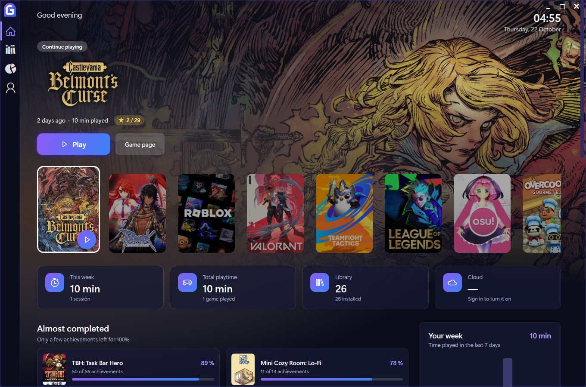
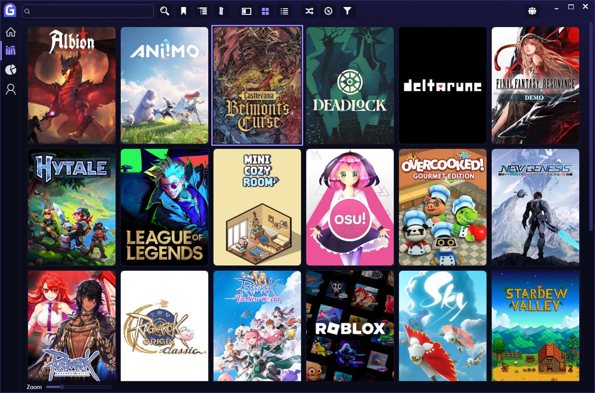
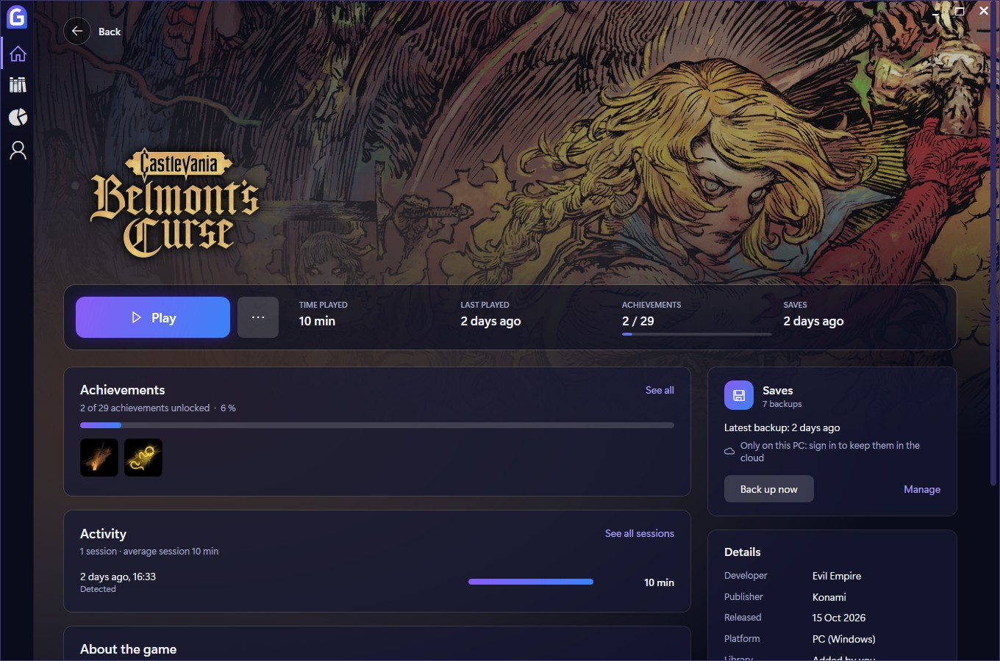
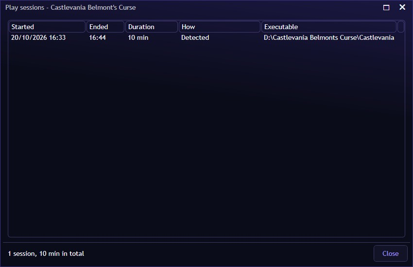
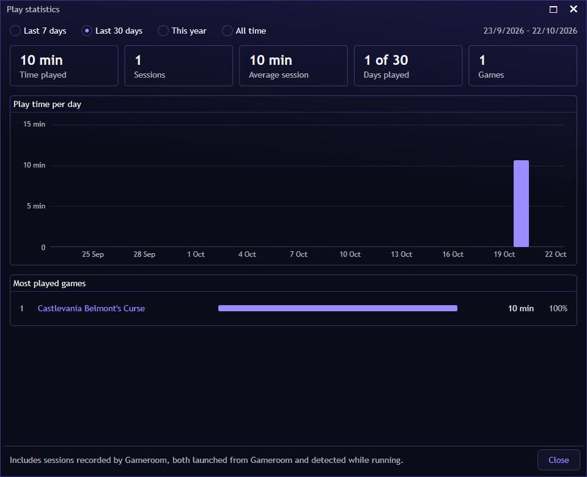
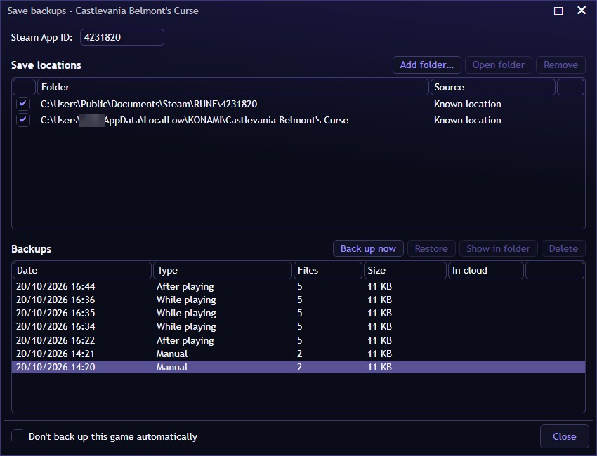
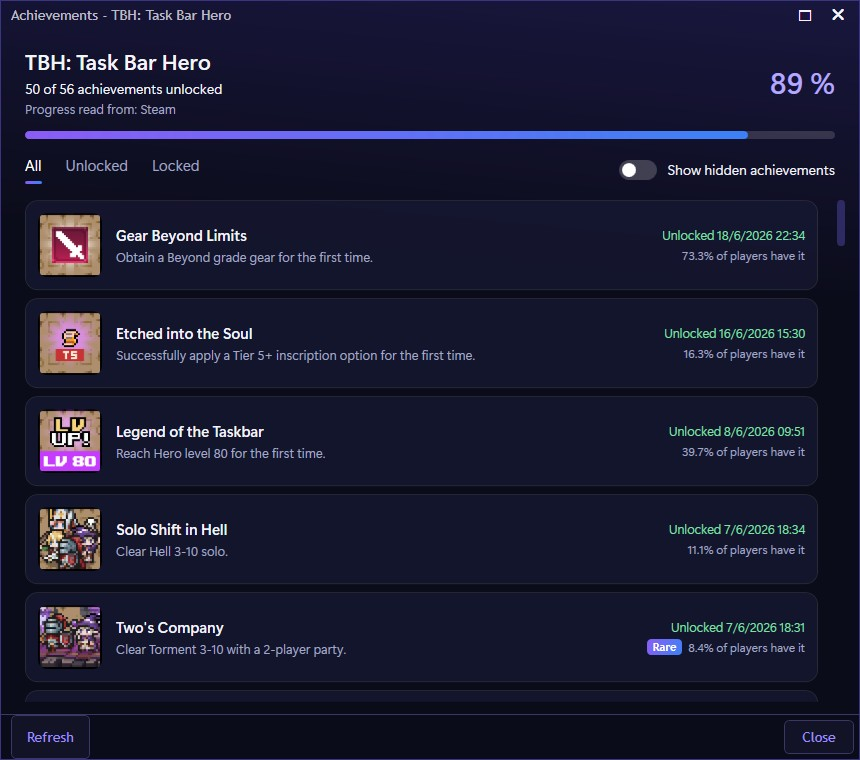
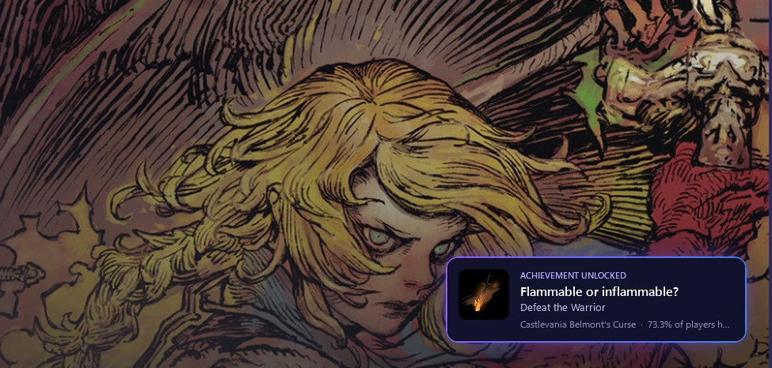
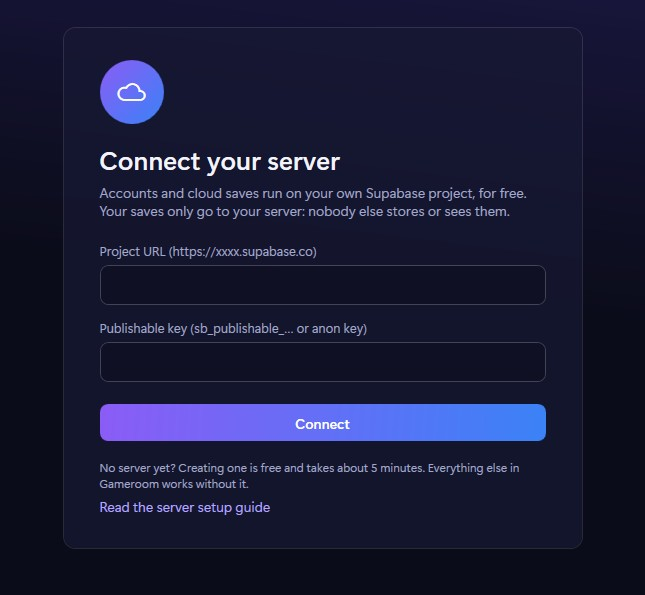
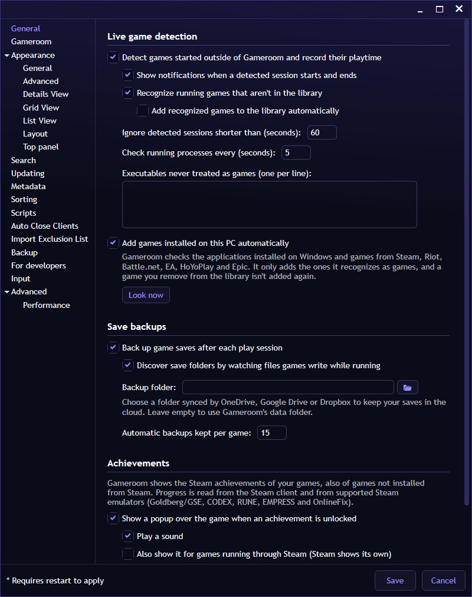

# Gameroom user guide

Everything Gameroom can do, screen by screen. New to Gameroom? Start with **[Getting started](GETTING_STARTED.md)**.

- [The interface at a glance](#the-interface-at-a-glance)
- [Home](#home)
- [Library](#library)
- [Game page](#game-page)
- [Adding games](#adding-games)
- [Playing and playtime](#playing-and-playtime)
- [Save backups](#save-backups)
- [Achievements](#achievements)
- [Account and cloud saves](#account-and-cloud-saves)
- [Settings](#settings)
- [Fullscreen mode](#fullscreen-mode)
- [Extensions and themes](#extensions-and-themes)
- [Updates](#updates)
- [Links and shortcuts](#links-and-shortcuts)
- [Your data](#your-data)

---

## The interface at a glance

| Where | What it does |
|---|---|
| **G button** (top left) | Opens the **main menu**: add games, update the library, play statistics, add-ons, settings, fullscreen mode and more. |
| **Home** | Your console-style start screen. |
| **Library** | All your games, with search, filters and three views. |
| **Statistics** | Library statistics: games by store, completion status, install size and most played. |
| **Account** | Connect your own server, sign in and manage cloud saves. |

Right-click any game in the library to open its **game menu**. It has Gameroom's per-game tools: game page, achievements, play sessions, save backups and Steam data.

---

## Home

The home screen is built around the games you play:

- **The hero.** The selected game fills the screen with its artwork and official logo, plus an ambient glow in the color of its cover. Under the logo you see when you last played it, your playtime and your achievement progress. The label above it tells you why it's there: *Continue playing* or *New in your library*.
- **Play** starts the game. **Game page** opens its [game page](#game-page).
- **The carousel** shows your recently played games, then the ones you added recently:
  - Rest the pointer on a tile to bring that game to the hero.
  - Click a tile to open the game's page, or use the play button on the selected tile to start it.
  - Scroll the mouse wheel over the carousel to move through it.
  - *All games*, at the end, opens the library.
- **This week, Total playtime, Library and Cloud** summarize your time played, your games, and how many save backups are in your cloud.
- **Almost completed** lists the games where you're only a few achievements away from 100%.
- **Installed, never played** reminds you of games waiting for you.
- **Your week** charts your daily playtime over the last 7 days.
- **Recent achievements** shows your latest unlocks across all games.

The home screen refreshes by itself when games are added or their artwork arrives, without flickering.

---

## Library

The library shows every game, from every store and source:

- **Views:** use the buttons at the top for **Details** (a list with a details panel), **Grid** (covers, with a zoom slider at the bottom) or **List**.
- **Search** with the box at the top left.
- **Filter, sort and group** with the filter button, the explorer panel and the sort options. You can filter by store, platform, genre, completion status and more, and save filter presets.
- **Random game:** the shuffle button picks something for you to play.
- **Hover a cover** in grid view to get its **Play** and **details** buttons.

Library management comes from Playnite. The [Playnite manual](https://api.playnite.link/docs/manual/gettingStarted/playniteOverview.html) covers it in depth: filters, editing games, tags, metadata, and the Library Manager.

---

## Game page

Every game has its own page. Open it from **Game page** on the home screen, from **Game page** in the game menu, or with the link `gameroom://playnite/game/<id>`.

- **Play** (or **Install**) starts the game. The **…** button has *Show in library*, *Open game folder* and *Edit details*.
- **The stats bar** shows time played, last played, achievements and the date of the latest save backup.
- **Achievements** shows your progress and the latest unlocks, with **See all** for the full list. If you have one, *Your rarest achievement* is highlighted too.
- **Activity** shows your latest sessions, your average session length, and **See all sessions**.
- **Saves** shows how many backups exist and whether they're in your cloud, with **Back up now** and **Manage**.
- **About the game** and **Details** show the description, developer, publisher, release date, platform, source, size and date added.

**Back**, at the top left, returns to where you were.

---

## Adding games

Gameroom fills your library in several ways. You don't have to choose: use all of them.

### Automatically: installed games

Gameroom finds the games installed on your PC on startup, every 20 minutes, and when you ask it to (**main menu → Update Game Library → Find games installed on this PC**). It looks at:

- **Windows' installed apps.**
- **Store and launcher games:** Steam, Epic, Xbox / Microsoft Store, Riot (VALORANT, League of Legends, Teamfight Tactics), Battle.net, EA and HoYoPlay.
- **Games inside launchers,** like the ones in a launcher's `games` folder. They're added with the game's real name and start through their launcher.
- **Desktop and Start menu shortcuts** to games.
- **Portable games:** the top-level folders of your drives, and the folders inside a `Games` or `Juegos` folder.

Something is only added when there's strong evidence that it's a game: a launcher registration, game engine files (Unity, Unreal, Godot, GameMaker, Ren'Py, RPG Maker…), Steam API files, or a repack installer. Each new game gets an icon, the *PC (Windows)* platform, and a cover and background from Steam or IGDB.

Gameroom remembers every app it checked:

- **A game you remove from the library is not added again.**
- **Leftovers of uninstalled games** (Windows entries whose folder was deleted) are ignored.
- **A game already in the library** that was reinstalled is marked as installed again, and keeps its playtime and backups.

You can turn automatic detection off in [Settings](#settings).

### With store extensions

Extensions import your store libraries, including games you own but haven't installed. Install them from **main menu → Add-ons…** (for example Steam, Epic, GOG, Battle.net, EA, Ubisoft, itch.io or Xbox), then use **main menu → Update Game Library**.

When a store's extension is installed, Gameroom leaves that store's games to the extension, so nothing is added twice.

### By playing them

Start a game that isn't in your library, from anywhere, and Gameroom recognizes it while it runs.

- **Games with a recognizable engine** (Unity, Unreal, Godot, GameMaker, Ren'Py, RPG Maker) or Steam files are added right away, keeping the playtime of the current session. A card over the game tells you: *Added to your library*. The game gets its icon, cover and details like any other.
- **Programs with weaker signs of being a game** (a fullscreen program that ships game libraries) are only offered. A card says *New game detected*, and the notifications in Gameroom (the bell in the library) let you **Add to library**, or choose *Not a game, don't ask again*.

A game you remove from the library isn't added again. You can turn automatic adding off in [Settings](#settings).

### By hand

Use **main menu → Add Game**:
- **Manually…** for any program.
- **Scan Automatically…** to pick from installed programs.
- **Emulated Game…** for ROMs with your emulators.

---

## Playing and playtime

Start games from Gameroom, or however you like: a desktop shortcut, the game's folder, Steam, another launcher. Gameroom recognizes the running game either way:
- By the game's executables.
- By its install folder.

- **Live playtime:** time is added to the game **every minute** while you play, so it shows up right away.
- **Sessions are safe.** The session in progress is saved as you play, so the time isn't lost if Gameroom closes or the PC shuts down.
- **Launchers aren't games:** a store client running (Steam, the Riot client, a game's launcher) doesn't count as playing the game. Only the game itself does.
- **Notifications** tell you when Gameroom starts and stops tracking a game (*Gameroom is tracking your time in…*). You can turn them off.

### Play sessions

**Game menu → Play sessions…** (or *See all sessions* on the game page) lists every session:
- When it started and ended, and how long it lasted.
- **How** it was recorded: *Launched from Gameroom* or *Detected*.
- The executable that ran.

### Play statistics

**Main menu → Play statistics…** shows your gaming habits for the last 7 days, the last 30 days, this year or all time:
- Total time, number of sessions, average session, days played and games played.
- A chart of your playtime per day, week or month.
- Your most played games. Click one to find it in the library.

---

## Save backups

Gameroom protects your progress by copying your save files, for games from any store and also for standalone games.

### How backups are made

- **While you play,** every minute, when the saves changed (*While playing*).
- **When you quit the game** (*After playing*).
- **When you ask for it,** with **Back up now** (*Manual*).
- **Right before a restore** (*Before restore*), so a restore can always be undone.

Backups are versioned ZIP files. A backup is skipped when nothing changed since the last one. For each game, Gameroom keeps:
- The newest backups made after playing or before a restore: 15 by default, configurable.
- The newest 5 backups made while playing.
- Every manual backup, until you delete it.

### Where Gameroom finds saves

- **Known locations:**
  - Steam's `userdata`.
  - The folders of Steam emulators (Goldberg/GSE, CODEX, RUNE, EMPRESS, OnlineFix, SmartSteamEmu, CPY, SKIDROW…).
  - Unity's `LocalLow\Company\Product`, Unreal project folders, and folders named after the game.
- **Learned locations:** while a game runs, Gameroom watches which files it writes, and discovers save folders nobody listed.
- **Your own folders:** add any folder by hand.

### The save backups window

Open it with **game menu → Save backups → Manage backups and save locations…** or **Manage** on the game page.

- **Steam App ID:** used to find the saves of Steam emulators and Steam Cloud. It's detected automatically when possible.
- **Save locations:** the folders that are backed up, and where each one comes from (*Known location*, *Discovered while playing*, *Added by you*):
  - Uncheck a folder to stop backing it up.
  - **Add folder…** adds one.
  - **Open folder** shows it.
  - **Remove** deletes a folder you added.
- **Backups:** every backup with its date, type, number of files, size and whether it's *In cloud*. You can **Back up now**, **Restore**, **Show in folder** or **Delete**.
- **Don't back up this game automatically** turns automatic backups off for this game only.

### Restoring

- **Game menu → Save backups → Restore latest backup** restores the newest backup in one click.
- Pick an older one in the save backups window and click **Restore**.
- Close the game before restoring. Gameroom asks you to if it's running.

**After reinstalling a game or Windows,** if a game has backups but no saves on this PC, Gameroom offers to restore them with a notification: *Gameroom has a backup of your saves…*. It also recognizes:
- Backups of an older library entry of the same game.
- Backups already in the backup folder.
- Backups in your cloud.

**Keep backups in the cloud without an account:** in [Settings](#settings), set the backup folder to a folder synced by OneDrive, Google Drive or Dropbox.

---

## Achievements

Gameroom shows the **Steam achievements of your games**, including games you didn't install from Steam:
- **The game's achievements** (names, icons, descriptions in your language, hidden ones, and the share of players who unlocked each) come from Steam's public API.
- **Your progress** is read from the Steam client and from the files of supported Steam emulators: Goldberg/GSE, CODEX, RUNE, EMPRESS and OnlineFix.

Open them with **game menu → Achievements…**, **See all** on the game page, or the link `gameroom://playnite/achievements/<id>`. In the window:

- The header shows your progress and where it was read from (*Progress read from: Steam*).
- **All / Unlocked / Locked** filter the list. **Show hidden achievements** reveals the secret ones.
- *Rare* marks achievements that few players have.
- **Refresh** reads your progress again.
- **If the game wasn't found on Steam,** enter its Steam AppID (the number in the address of its store page) and click **Use AppID**.

### The achievement notification

When you unlock an achievement, an animated card with a sound appears over the game, at the bottom right. It doesn't steal focus from the game.

- **Rare achievements** get a special mention with their percentage.
- It works in **windowed** and **borderless fullscreen** games. Windows doesn't allow anything over *exclusive* fullscreen games: switch the game to borderless if you don't see it.
- **Steam games** show Steam's own notification, so Gameroom's is off for them by default. You can turn it on.
- **Test popup** in [Settings](#settings), or the link `gameroom://playnite/achievementpreview`, shows you how it looks.

---

## Account and cloud saves

Cloud saves keep your backups safe and bring them to any PC. They run on **your own free Supabase server**, so your saves never go to anyone else. Setting one up takes about 5 minutes: see **[Your own Gameroom server](SUPABASE.md)**.

1. In **Account**, paste your **Project URL** and **publishable key**, and click **Connect**.
2. **Create account** (email, password and username), or **Sign in**.
3. From then on, every save backup is uploaded automatically. **Sync now** uploads and downloads right away.

Once signed in, **Account** shows your profile, your total playtime, the games you played, and a summary of your cloud saves for each game. **Upload every save backup automatically** can be turned off if you'd rather sync by hand.

On another PC, sign in with the same account: the backups that are missing there are downloaded, and Gameroom offers to restore them when a game has no saves.

To use another server, sign out and click **Change server**.

---

## Settings

**Main menu → Settings… → Gameroom** has Gameroom's own options. You can also open it with `gameroom://playnite/settings/gameroom`.

**Live game detection**

| Option | What it does |
|---|---|
| Detect games started outside of Gameroom and record their playtime | Recognizes library games however they're started. |
| Show notifications when a detected session starts and ends | The *tracking your time* notifications. |
| Recognize running games that aren't in the library | Notices games you play that aren't in your library. |
| Add recognized games to the library automatically | Adds games with a recognizable engine right away (on by default). Others are offered in the notifications. |
| Ignore detected sessions shorter than (seconds) | Skips accidental launches (60 by default). |
| Check running processes every (seconds) | How often running games are checked (5 by default). |
| Executables never treated as games | One per line, for programs that look like games but aren't. |
| Add games installed on this PC automatically | Automatic detection of installed games. **Look now** runs it right away. |

**Save backups**

| Option | What it does |
|---|---|
| Back up game saves after each play session | Automatic backups. |
| Discover save folders by watching files games write while running | Learned save locations. |
| Backup folder | Where backups are stored. Choose a OneDrive, Google Drive or Dropbox folder to keep them in the cloud. Empty means Gameroom's data folder. |
| Automatic backups kept per game | How many automatic backups to keep (15 by default). |

**Achievements**

| Option | What it does |
|---|---|
| Show a popup over the game when an achievement is unlocked | The achievement notification. |
| Play a sound | The notification's sound. |
| Also show it for games running through Steam | Off by default, because Steam shows its own. |
| Test popup | Shows a sample notification. |

The other sections of the settings (appearance, metadata, updates, input, backup of the library…) are Playnite's. See the [Playnite manual](https://api.playnite.link/docs/manual/gettingStarted/playniteOverview.html).

---

## Fullscreen mode

**Main menu → Switch to Fullscreen Mode**, or the *Gameroom (fullscreen)* shortcut in the Start menu, opens a TV and controller friendly interface with Gameroom's colors. It's Playnite's fullscreen mode. Gameroom's new views (Home, game page, Account) are only in desktop mode for now.

---

## Extensions and themes

Gameroom is compatible with Playnite's add-ons. Browse and install them from **main menu → Add-ons…**:

- **Libraries:** import games from stores (Steam, Epic, GOG, Battle.net, EA, Ubisoft, Xbox, itch.io, Amazon…).
- **Metadata sources:** download covers, descriptions and more (IGDB, Steam, SteamGridDB…).
- **Generic extensions:** extra features made by the community.
- **Themes:** change the look of desktop and fullscreen modes.

On first start, Gameroom can import the add-ons and themes of an installed Playnite.

---

## Updates

Gameroom checks for updates on startup and every 4 hours. When a new version is out on [Releases](https://github.com/Cyssel/Gameroom/releases), it shows what's new and updates itself:
1. The updater downloads the installer.
2. It checks the installer against the SHA-256 published by GitHub.
3. It waits for Gameroom to close, installs, and opens Gameroom again.

You can also check by hand with **Check for Gameroom updates** in the Start menu.

Your library, playtime and backups are kept across updates.

---

## Links and shortcuts

Gameroom understands `gameroom://` links. Put them in desktop shortcuts, a Stream Deck or scripts:

| Link | Opens |
|---|---|
| `gameroom://playnite/open/home` | Home (also `library`, `statistics`, `account`) |
| `gameroom://playnite/game/<game id>` | A game's page |
| `gameroom://playnite/showgame/<game id>` | A game, selected in the library |
| `gameroom://playnite/start/<game id>` | Starts a game |
| `gameroom://playnite/achievements/<game id>` | A game's achievements |
| `gameroom://playnite/sessions/<game id>` | A game's play sessions |
| `gameroom://playnite/saves/<game id>` | A game's save backups |
| `gameroom://playnite/playstats` | Play statistics |
| `gameroom://playnite/settings/gameroom` | Gameroom's settings |
| `gameroom://playnite/achievementpreview` | A sample achievement notification |

A game's id is the name of its folder in `%AppData%\Gameroom\library\files`. That folder holds the game's cover and icon.

---

## Your data

| What | Where |
|---|---|
| Library (games, metadata, covers) | `%AppData%\Gameroom\library` |
| Gameroom's data (sessions, save locations, achievements, backup index) | `%AppData%\Gameroom\library\gameroom.db` |
| Save backups | `%AppData%\Gameroom\SaveBackups`, or the folder you chose |
| Settings | `%AppData%\Gameroom\config.json` |
| Extensions and their data | `%AppData%\Gameroom\Extensions`, `%AppData%\Gameroom\ExtensionsData` |
| Logs | `%AppData%\Gameroom\gameroom.log`, `extensions.log` |
| Cloud session (encrypted) | `%AppData%\Gameroom\cloud-session.dat` |

Gameroom never sends your data anywhere except your own server, if you connect one. When you uninstall Gameroom, the uninstaller asks whether to delete your library, playtime and backups, or keep them for later.
